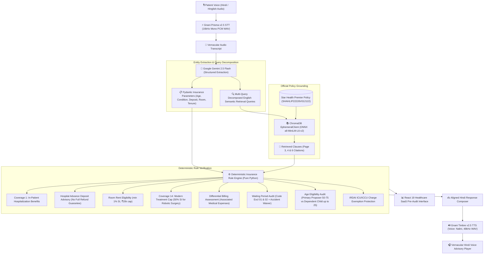

# BimaSakshi (बीमासाक्षी)
### Voice-Driven Health Insurance Pre-Audit & Vernacular Advisory Platform
> *"Understand your health insurance before the hospital bill arrives."*

Built for the **Great Indian AI Internship Challenge 2026**.

---

## 📌 Executive Summary & Project Overview

In India, health insurance policyholders frequently encounter catastrophic out-of-pocket hospital deductions (often 30% to 50% of the entire bill) upon discharge. These deductions stem from complex, fine-print policy clauses that patients and families cannot easily interpret during medical distress:

1. **Room-Rent Sub-Limits & Proportionate Deductions**: Exceeding the daily room eligibility (typically 1% of the Sum Insured) triggers proportionate deductions across all associated medical expenses (surgeon fees, operation theatre, doctor consultations, nursing).
2. **Specified Disease Waiting Periods (Code Excl 02)**: Common planned surgeries (such as kidney stones / renal calculi) are subject to mandatory 24-month waiting periods unless covered by continuous prior portability. Crucially, claims arising from accidental injuries are exempt.
3. **Pre-Existing Disease (PED) Waiting Periods (Code Excl 01)**: Declared chronic conditions require up to 24–48 months of continuous coverage, provided they were declared and explicitly accepted by the insurer.
4. **Modern Treatment Sub-Limits (Coverage 14)**: Modern surgical methods such as robotic surgeries are capped at 50% of the Sum Insured (or ₹5,00,000 for a ₹10 Lakh policy).
5. **Hospital Admission Deposits**: Advance security deposits requested by hospitals during admission are not approved insurance deductions, and full refunds are never guaranteed following cashless authorization.
6. **Age & Floater Membership Criteria**: Products such as Star Health Premier impose specific age brackets (e.g., 50–75 primary entry vs. dependent child up to 25 under Family Floater).

**BimaSakshi** bridges this gap by enabling patients and families to speak naturally in **Hindi or Hinglish** about their planned hospitalization. The platform transcribes the speech, extracts insurance variables, semantically retrieves authentic clauses from official policy documents, executes deterministic mathematical deductions without LLM hallucinations, and speaks back an actionable Hindi voice advisory.

---

## 🌟 Key Features

- **Voice-In, Voice-Out Vernacular Interaction**: Speak naturally in Hindi or Hinglish; receive a clear, spoken Hindi audio explanation synthesized using Gnani Timbre v2.5.
- **Strict Entity Separation**: Segregates hospital admission deposits (e.g., ₹30,000) from room rent, treatment costs, and total bills.
- **Authentic Official Policy Grounding**: Indexes and cites official clauses from the Star Health Premier Insurance Policy (UIN: `SHAHLIP22226V012122`), complete with PDF page numbers.
- **Multi-Intent Analysis**: Answers complete user queries encompassing in-patient benefits, hospital admission deposits, waiting periods, and age eligibility in a single interaction.
- **Zero Hallucination Deterministic Rule Engine**: Policy calculations (1% room rent cap, proportionate deductions, modern treatment limits) are evaluated strictly in Python—never hallucinated by generative models.
- **Transparent Missing-Information Auditing**: Missing parameters (`sum_insured`, `policy_tenure_months`, `hospital_differential_billing`) remain strictly `null` and are clearly badged as `[Illustrative Only]` when demonstration baselines are used.
- **IRDAI Regulatory Safeguards**: Enforces statutory protections, including the non-applicability of proportionate deductions to Intensive Care Unit (ICU/ICCU) charges.

---

## 🏗️ Multi-Modal AI Pipeline Architecture



---

## 🎙️ Gnani AI Integration Architecture

BimaSakshi leverages **Gnani AI (Vachana)** APIs for vernacular Indian voice processing:

### 1. Speech-to-Text: Gnani Prisma v2.5
- **Endpoint**: `https://api.vachana.ai/stt/v3`
- **Language**: `hi-IN` (Hindi with robust code-mixed Hinglish recognition)
- **Audio Conditioning**: Backend normalizes all incoming browser audio formats (WebM, Opus, MP3, M4A, OGG) in-memory using FFmpeg into **16,000 Hz 16-bit mono PCM WAV** before transmission.
- **Performance**: Average STT transcription latency is **~0.60 seconds** on live audio.
- **Resilience**: Configured with automated retries and fallback to multi-part decoding on unexpected network interruptions.

### 2. Text-to-Speech: Gnani Timbre v2.5
- **Endpoint**: `https://api.vachana.ai/api/v1/tts/inference`
- **Voice**: `Nalini` (Warm, natural Hindi speaker profile)
- **Model**: `timbre-v2.5`
- **Output Format**: Base64-encoded **48,000 Hz WAV audio**.
- **Contextual Tuning**: Advisory text is composed using Devanagari script with natural punctuation pauses, ensuring clear delivery of complex insurance conditions, numbers, and currency figures.

---

## 🛡️ Authentic Policy Grounding: Star Health Premier

All policy rules and vector embeddings in BimaSakshi are indexed directly from the official **Star Health Premier Insurance Policy**:
- **Insurer**: Star Health and Allied Insurance Company Limited
- **Product Name**: Star Health Premier Insurance Policy
- **UIN**: `SHAHLIP22226V012122`
- **Document Version**: `POL / SHP / V.6 / 2023`
- **Official Policy URL**: [Star Health Premier Policy PDF](https://www.starhealth.in/)

### Indexed Authentic Clauses & Exact Page Citations
| Clause ID | Clause Title | Policy Section | Source Page | Summary / Rule Impact |
|---|---|---|---|---|
| `STAR-PREMIER-ROOM-001` | Room Rent, Boarding and Associated Medical Expenses | Section 1 (Coverage B.1) | **PDF Page 3** (Def. on Page 2) | Eligible room rent: 1% of Sum Insured up to max ₹20,000/day. Proportionate deduction applies to associated medical charges if room rent exceeds eligibility and hospital practices differential billing. In-patient benefits include surgeon, anesthetist, OT, medicines, diagnostic, and day-care procedures. |
| `STAR-PREMIER-WAIT-002` | Specified Disease / Procedure Waiting Period | Section 4 (Code - Excl 02) | **PDF Page 6** | 24-month continuous coverage waiting period for calculus of gall bladder, kidney, and urinary tract. **Accidental claims are strictly exempt.** Credit is given for continuous prior coverage under portability norms. |
| `STAR-PREMIER-PED-001` | Pre-Existing Diseases Waiting Period | Section 4 (Code - Excl 01) | **PDF Page 6** | 24-month waiting period for declared and accepted pre-existing conditions. Insurer acceptance in policy endorsement is mandatory. |
| `STAR-PREMIER-MODERN-014` | Modern Treatments / Advances in Technology | Coverage 14 | **PDF Page 4** | Sub-limit of 50% of Sum Insured applies to modern procedures including Robotic Surgeries (max ₹5,00,000 for ₹10 Lakh SI). |

---

## 💻 Technology Stack

### Backend
- **Language**: Python 3.11+ / 3.13
- **Web Framework**: FastAPI 0.115+ with Uvicorn ASGI server
- **Speech Recognition**: Gnani AI Prisma v2.5 STT REST API
- **Speech Synthesis**: Gnani AI Timbre v2.5 TTS REST API
- **Entity Extraction**: Google Gemini 2.5 Flash via `google-genai` SDK (`v1beta` structured JSON)
- **Vector Database**: ChromaDB (`EphemeralClient`) with cached ONNX `all-MiniLM-L6-v2` embeddings
- **Audio Processing**: FFmpeg with `pydub`
- **Testing**: Pytest (**95 automated tests passing**)

### Frontend
- **Framework**: React 19 + Vite 8
- **Design System**: Minimal Healthcare SaaS (Light Theme `#F8FAFC`, Inter + Noto Sans Devanagari typography)
- **Styling**: Tailwind CSS v4 (`@tailwindcss/vite`)
- **Icons**: Lucide React
- **Audio Capture**: HTML5 `MediaRecorder` API with dynamic fallback
- **Proxy**: Vite reverse proxy mapping `/api/*` and `/health` to FastAPI

---

## 🎯 5 Authentic Preset Demonstration Scenarios

BimaSakshi includes 5 authentic pre-recorded audio scenarios testable with one click in the UI:

| Scenario | Audio Asset | Condition / Question | Key Rule & Audit Outcome |
| :--- | :--- | :--- | :--- |
| **Scenario A** | `/calculi_scenario.wav` | 52-yr male, 14-mo policy, ₹10L SI, kidney calculi surgery, ₹30,000/day room. | ⚠️ Exceeds ₹10,000 daily limit by ₹20,000; subject to proportionate deductions; under 24-month waiting period unless continuous coverage portability applies. |
| **Scenario B** | `/accident_scenario.wav` | "Does the 24-month waiting period apply to accident surgeries?" | ✅ **Exempt**: Code Excl 02 explicit waiver applies immediately without waiting periods. |
| **Scenario C** | `/robotic_scenario.wav` | 58-yr female, 3-yr policy, ₹10L SI, robotic surgery with ₹6L estimate. | ⚠️ **Coverage 14 Cap**: Capped at 50% of Sum Insured (max ₹5,00,000); patient responsible for remaining ₹1,00,000. |
| **Scenario D** | `/ambiguous_kidney_scenario.wav` | "Mujhe kidney ki problem hai aur operation suggest kiya hai." | ❓ **Safeguard**: Generic condition flags `insufficient_information` and requests specific diagnosis without forcing Code Excl 02. |
| **Scenario E** | `/deposit_scenario.wav` | 24-yr male, Star Health, kidney stone surgery, ₹30,000 deposit, benefits inquiry. | 🛡️ **Multi-Intent**: Explains deposit as advance hospital payment (no full refund guarantee); outlines Coverage 1 in-patient benefits; audits 24-yr dependent child status; flags Code Excl 02 waiting period. |

---

## 🚀 Setup & Execution Guide

### Prerequisites
- Python 3.11 or higher
- Node.js 18 or higher (npm)
- FFmpeg installed and available in system `PATH`
- Gnani AI API Key (`GNANI_API_KEY`)
- Google Gemini API Key (`GEMINI_API_KEY`)

### 1. Environment Variable Configuration
Copy `.env.example` to `backend/.env`:
```powershell
cp .env.example backend/.env
```
Edit `backend/.env` and insert your credentials:
```ini
GNANI_API_KEY=your_gnani_api_key_here
GEMINI_API_KEY=your_gemini_api_key_here
```

### 2. Backend Setup & Startup
```powershell
# Navigate to backend directory
cd backend

# Create and activate virtual environment (optional)
python -m venv venv
.\venv\Scripts\activate

# Install dependencies
pip install -r requirements.txt

# Start FastAPI backend
python -m uvicorn main:app --host 127.0.0.1 --port 8000
```
Backend will be available at `http://127.0.0.1:8000`.
- API Documentation: `http://127.0.0.1:8000/docs`
- Health Check: `http://127.0.0.1:8000/health`

### 3. Frontend Setup & Startup
```powershell
# Navigate to frontend directory
cd frontend

# Install dependencies
npm install

# Start Vite development server
npm run dev
```
Open your browser at **`http://localhost:5173`**.

### 4. One-Click Startup (PowerShell)
From the project root:
```powershell
.\run_bimasakshi.ps1
```

---

## 🧪 Testing Suite & Verification

BimaSakshi includes an automated test suite of **95 tests** covering microservices, API schemas, multi-intent extraction, hospital deposit handling, age eligibility, and real-world edge cases:

```powershell
pytest backend/tests -v
```

### Test Coverage Highlights
- `backend/tests/test_unseen_scenarios_audit.py`: 10 comprehensive unseen Hindi/Hinglish scenarios validating multi-intent parsing, hospital deposit reconciliation, dependent child age rules, robotic surgery sub-limits, accident waivers, PED acceptance, day-care portability, and uniform vs. differential billing.
- `backend/tests/test_multi_intent_deposit_regression.py`: Regression tests for the 24-yr old kidney calculi scenario with hospital deposit and benefits inquiry.
- `backend/tests/test_policy_engine_v2_regression.py`: Evaluates core insurance rules (ambiguous kidney conditions, accident waivers, PED acceptance, Coverage 14 caps, ICU exemptions).
- `backend/tests/test_accident_intent_regression.py`: Verifies accident waiver intent extraction and advisory composition.
- `backend/tests/test_analysis_api.py`: Validates `/api/analyze-audio` payload handling, empty audio checks, and service error handling.
- `backend/tests/test_api.py`: Health checks, vector store status, and semantic clause retrieval.
- `backend/tests/test_gemini_service.py`: Schema validation, null field preservation, and query normalization.
- `backend/tests/test_policy_engine.py`: Room-rent 1% cap calculation, illustrative demonstration flags, tri-state differential billing, continuous portability credit, and accidental injury exceptions.
- `backend/tests/test_query_generalization.py`: Tests domain-agnostic query normalization across diverse surgical procedures.
- `backend/tests/test_vectorstore.py`: In-memory ChromaDB clause indexing, idempotency, and semantic search accuracy.

---

## ⚠️ Known Limitations & Operating Boundaries

1. **Policy Scope Boundary**:
   The demonstration vector store indexes core clauses of the Star Health Premier Insurance Policy (UIN: `SHAHLIP22226V012122`): In-Patient Hospitalization / Room Rent (Page 3), Modern Treatment / Robotic Surgeries (Page 4), Pre-Existing Diseases (Page 6), and Specified Disease Waiting Periods (Page 6). Non-indexed benefits (e.g., maternity, dental, AYUSH, overseas emergency) are surfaced as unindexed with instructions to consult the full policy contract.

2. **Hospital Billing Practice Dependency**:
   Proportionate deduction on associate medical expenses can only be determined if the hospital practices differential room billing. When differential billing status is unconfirmed, the system conservatively reports `insufficient_information` and requests verification from the hospital billing desk.

3. **Schedule Endorsement Verification**:
   The system cannot access the user's private policy schedule directly. Missing parameters (exact sum insured, active tenure, declared PED acceptance endorsement, co-payment endorsements) are systematically flagged in `missing_information`.

4. **Hospital Deposit Refund Disclaimer**:
   Advance admission deposits are hospital security charges. The system explicitly advises that refunds or adjustments depend on the insurer's approved cashless sanction minus non-payable expenses; a full refund is never guaranteed.

---

## ⚖️ Regulatory Disclaimer
*BimaSakshi is an artificial intelligence decision-support tool designed for informational pre-audits and pre-admission guidance. It does not issue or guarantee insurance claim approvals, alter policy schedules, or represent an official claim settlement by Star Health or any insurer.*
