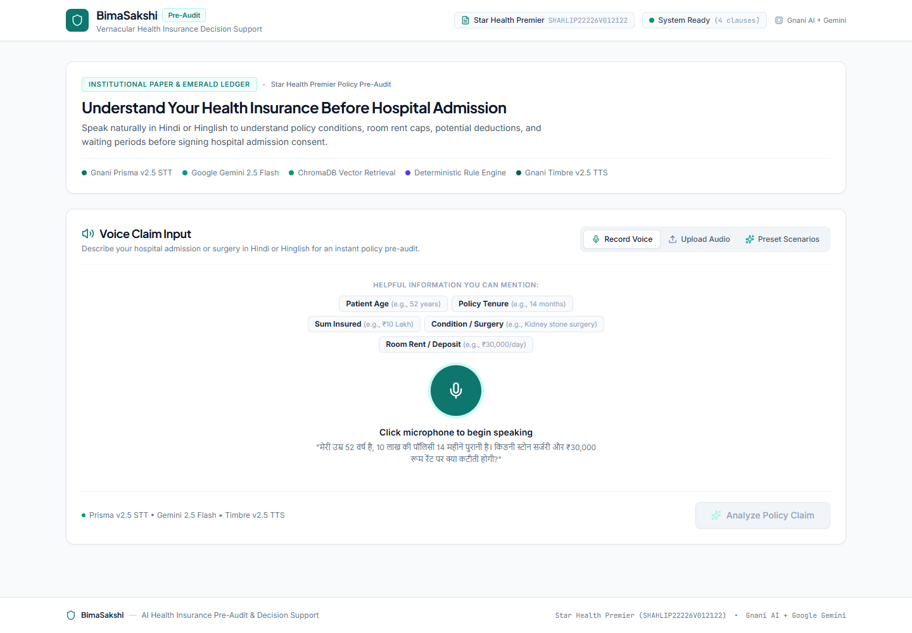
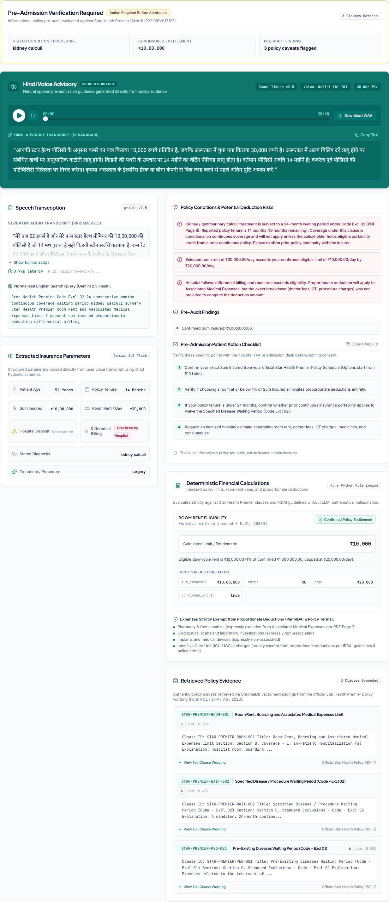
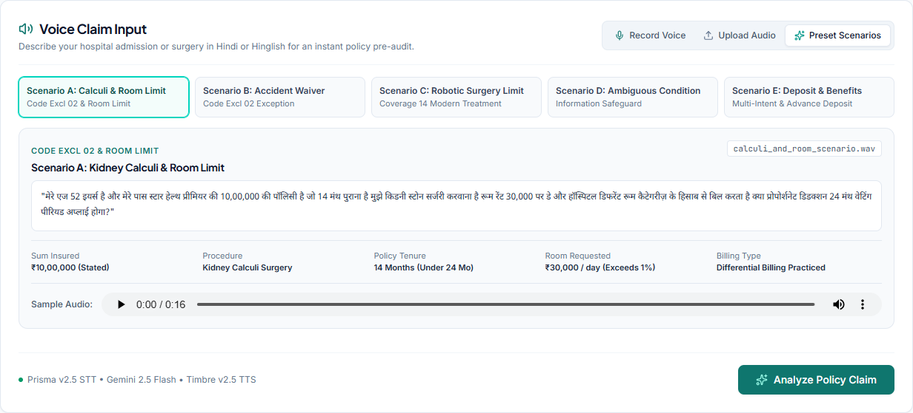
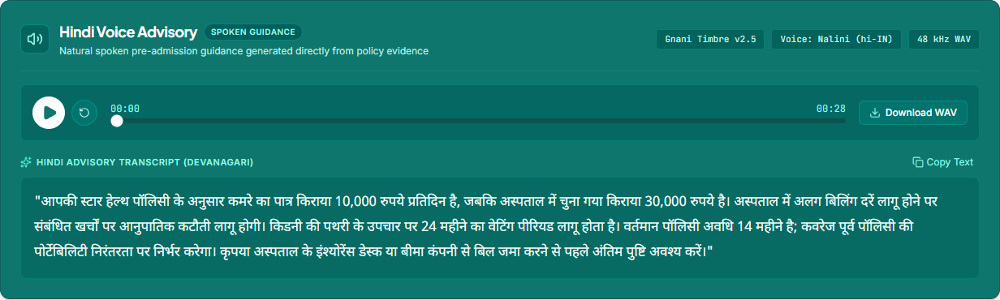
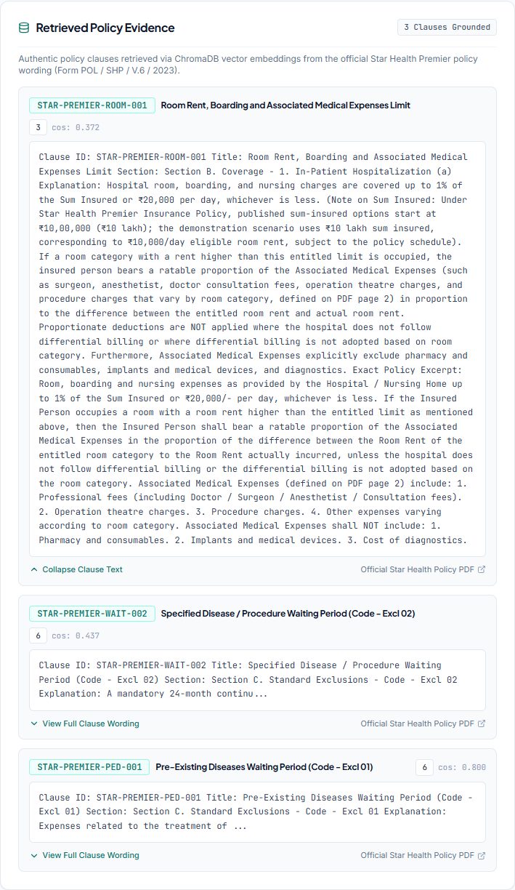
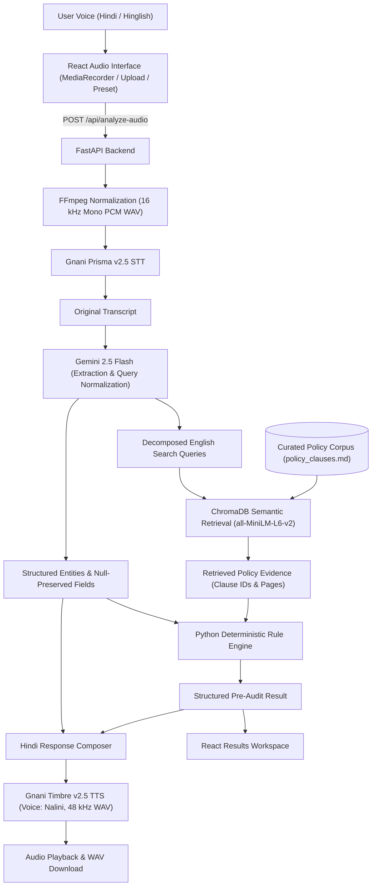

# BimaSakshi (बीमासाक्षी)

**Understand Your Health Insurance Before the Hospital Bill Arrives.**

BimaSakshi is an AI-powered, voice-first health insurance pre-audit assistant developed for the **Great Indian AI Internship Challenge 2026** by **Gnani AI** under the theme *"Build Sovereign AI for India"*. It helps Indian policyholders understand relevant policy rules through natural Hindi and Hinglish speech, grounded policy evidence, deterministic calculations, and a spoken Hindi advisory.

[](https://www.python.org/)
[](https://fastapi.tiangolo.com/)
[](https://react.dev/)
[](https://ai.google.dev/)
[](https://www.trychroma.com/)
[](https://www.gnani.ai/)
[](https://bima-sakshi.vercel.app/)
[](https://bimasakshi-backend.onrender.com/health)

**Live App:** [bima-sakshi.vercel.app](https://bima-sakshi.vercel.app/) · **Backend Health:** [bimasakshi-backend.onrender.com/health](https://bimasakshi-backend.onrender.com/health) · **Repository:** [Bharadwaj710/BimaSakshi](https://github.com/Bharadwaj710/BimaSakshi)

---

## Why I Built BimaSakshi

Imagine a family preparing to admit their father for kidney stone surgery. They hold a ₹10 lakh health insurance policy, have completed 14 months of coverage, and the hospital recommends a room costing ₹30,000 per day.

Before signing admission paperwork, the family needs clear answers to five questions:

- Does a waiting period apply at 14 months of policy tenure?
- What does their daily room-rent limit actually mean in rupees?
- Could selecting a ₹30,000/day room trigger **proportionate deductions** on surgeon and operation theatre bills?
- Is an advance admission deposit asked by the hospital the same as room rent?
- What should they confirm with the hospital billing desk or TPA prior to admission?

Finding those answers inside a dense English policy PDF while preparing for surgery is difficult for most families. General-purpose chatbots often sound confident while inventing policy math or missing critical billing caveats.

**BimaSakshi** approaches this as a structured pre-audit rather than an open-ended chat. It pairs vernacular speech recognition and voice output from **Gnani AI**, structured extraction via **Gemini**, semantic clause lookup via **ChromaDB**, and deterministic calculations written in **Python**.



---

## Product Showcase

The screenshots below were captured directly from the live deployed application ([https://bima-sakshi.vercel.app/](https://bima-sakshi.vercel.app/)) using the built-in kidney-stone pre-audit scenario (52-year-old policyholder, ₹10,00,000 sum insured, 14 months tenure, ₹30,000/day room at a hospital with differential billing).

### Completed Policy Pre-Audit Workspace



### Key Interaction Views

<details open>
<summary><strong>1. Voice Input &amp; Preset Scenarios</strong> — Record via browser microphone, upload audio, or select a sample query</summary>



</details>

<details open>
<summary><strong>2. Hindi Voice Advisory</strong> — Spoken guidance from Gnani Timbre v2.5 with browser playback and WAV download</summary>



</details>

<details open>
<summary><strong>3. Grounded Policy Evidence</strong> — Retrieved clauses with exact clause IDs and printed PDF page references</summary>



</details>

---

## How BimaSakshi Works

1. **Choose an input mode:** Record spoken Hindi or Hinglish in the browser, upload an audio file (`.wav`, `.mp3`, `.m4a`, `.ogg`, `.webm` up to 10 MB), or load one of five preset audio scenarios.
2. **Transcribe speech:** The backend converts incoming audio into standard 16 kHz mono WAV with FFmpeg and sends it to **Gnani Prisma v2.5** to capture the verbatim transcript.
3. **Extract structured details:** **Google Gemini 2.5 Flash** parses spoken numbers, medical conditions, room rent, deposits, and questions into a strict schema, keeping unmentioned fields `null`.
4. **Retrieve policy clauses:** BimaSakshi converts Gemini's decomposed search queries into embeddings and uses **ChromaDB** to retrieve the policy passages most relevant to the user's question.
5. **Run deterministic rules:** A **Python rule engine** checks supported limits, waiting periods, and deductions using the extracted values and matched clauses.
6. **Present findings and Hindi audio:** The React interface displays the transcript, extracted parameters, calculation receipt, clause evidence, hospital/TPA checklist, and a spoken **Hindi advisory** generated by **Gnani Timbre v2.5**.

| Output Panel | Purpose for the Policyholder |
| :--- | :--- |
| **Executive Summary** | Highlights whether findings are complete or require schedule/hospital verification. |
| **Hindi Voice Advisory** | Dark-teal audio player (`play/pause`, scrubber, `.wav` download) paired with Devanagari text. |
| **Speech Transcription** | Displays the original transcript verbatim alongside the English search queries used for lookup. |
| **Extracted Parameters** | Separates age, tenure, sum insured, diagnosis, daily room rent, deposit, and billing practice; unstated items show `Not provided`. |
| **Findings & Action Checklist** | Summarizes conditions, potential deduction risks, and copyable questions for the hospital TPA desk. |
| **Financial Calculation Receipt** | Shows formulas, inputs, and rupee limits; benchmark assumptions are clearly badged `Illustrative Only`. |
| **Retrieved Policy Evidence** | Lists matching clauses with IDs, printed PDF page numbers, expandable wording, and the source PDF link. |

---

## Technical Architecture



### Why the AI Pipeline Separates Responsibilities

BimaSakshi deliberately divides work across four focused stages rather than asking a single LLM to answer everything in one prompt:

1. **Language understanding (`Gemini 2.5 Flash`):** Interprets colloquial Hindi/Hinglish speech into typed Pydantic fields (`ExtractedInsuranceInfo`) and splits multi-part questions into focused search queries. Gemini does **not** decide final claim math or waiting-period outcomes.
2. **Evidence retrieval (`ChromaDB`):** Matches decomposed queries against curated Star Health Premier clause text stored in an in-memory vector collection (`EphemeralClient`) with ONNX `all-MiniLM-L6-v2` embeddings.
3. **Deterministic calculations (`policy_engine.py`):** Evaluates supported rules in plain Python—room-rent caps (`1%` of Sum Insured up to `₹20,000/day`), tri-state differential billing math, waiting-period conditions, modern treatment limits, and missing-input warnings.
4. **Spoken response synthesis (`response_service.py` + `Timbre v2.5`):** Builds Hindi guidance strictly from verified findings and calculations, failing gracefully to text-only if speech synthesis is unavailable.

Separating extraction from Python rule evaluation avoids LLM arithmetic errors, though speech-to-text mishearing or extraction mistakes can still occur and require user review.

---

## Powered by Gnani AI

BimaSakshi is designed around **voice-in, voice-out** accessibility for Indian families using two Gnani AI models:

- **Gnani Prisma v2.5 (Speech-to-Text):** Converts browser-captured audio (normalized to 16 kHz mono PCM WAV) into text, handling Hindi and everyday code-mixed Hinglish terms like *"14 month purana policy"* or *"30,000 per day"*. The raw transcript is preserved without silent rewriting.
- **Gnani Timbre v2.5 (Text-to-Speech):** Speaks the final Hindi advisory using the `Nalini` voice (`hi-IN`, 48 kHz WAV returned for browser playback and `.wav` download), letting policyholders listen calmly or replay guidance at the hospital desk.

---

## Policy Knowledge and Evidence Grounding

The current demonstration uses curated clauses from **one** policy document stored in [`backend/data/policy_clauses.md`](backend/data/policy_clauses.md):

- **Insurer:** Star Health and Allied Insurance Company Limited
- **Product Name:** Star Health Premier Insurance Policy
- **UIN:** `SHAHLIP22226V012122`
- **Document Version:** `POL / SHP / V.6 / 2023`
- **Source PDF:** [Health-Premier-Insurance-Policy.pdf](https://web.starhealth.in/sites/default/files/policy-clauses/Health-Premier-Insurance-Policy.pdf)
- **Indexed Clause Records:** **4** curated clauses

| Clause ID | Clause Title | Policy Section / Code | Printed PDF Page |
| :--- | :--- | :--- | :--- |
| `STAR-PREMIER-ROOM-001` | Room Rent, Boarding and Associated Medical Expenses Limit | `Section B. Coverage - 1. In-Patient Hospitalization (a)` | Page 3 *(Associated Medical Expenses definition: Page 2)* |
| `STAR-PREMIER-WAIT-002` | Specified Disease / Procedure Waiting Period (Code - Excl 02) | `Section C. Standard Exclusions - Code - Excl 02` | Page 6 |
| `STAR-PREMIER-PED-001` | Pre-Existing Diseases Waiting Period (Code - Excl 01) | `Section C. Standard Exclusions - Code - Excl 01` | Page 6 |
| `STAR-PREMIER-MODERN-014` | Coverage for Modern Treatment (Robotic Surgeries) | `Section II, Coverage 14 – Coverage for Modern Treatment` | Page 4 |

### Accuracy Principles in Policy Evaluation

- **Curated, version-tagged grounding:** Indexing verified clause records with exact UIN, version, and printed PDF page references avoids mixing terms across unrelated products.
- **Distinction between wording and personal schedules:** Retrieving policy wording does not confirm personal coverage; final eligibility depends on the policyholder's schedule, policy start date, portability continuity, accepted pre-existing disease endorsements, and co-payments.
- **Policy-defined exclusions from proportionate deductions:** Under `STAR-PREMIER-ROOM-001` and the implemented rule engine, items such as **pharmacy and consumables**, **implants and medical devices**, **diagnostics**, and **ICU/ICCU charges** are treated as *exclusions from associated medical expenses / proportionate deductions* rather than blanket exclusions from policy coverage—and rules here apply strictly to the indexed Star Health Premier logic, not universally across all insurers.
- **Ambiguity and deposit safeguards:** Generic mentions such as *"kidney problem"* are never auto-mapped to kidney calculi (`Code Excl 02`), hospital advance deposits are kept distinct from daily room rent (without guaranteeing full refunds), and missing Sum Insured triggers an explicit `Illustrative Only` `₹10,00,000` benchmark rather than a personalized claim figure.

---

## Implemented Features

- Browser microphone recording (`MediaRecorder`), audio upload, and 5 pre-loaded Hindi/Hinglish sample `.wav` scenarios
- In-memory FFmpeg audio conditioning to 16 kHz mono PCM WAV + Gnani Prisma v2.5 transcription
- Gemini 2.5 Flash structured extraction with strict `null` preservation for unstated fields
- Multi-intent query decomposition and ChromaDB semantic policy clause retrieval
- Deterministic Python rule evaluation for room-rent limits, differential billing, waiting periods (`Code Excl 01` / `02`), robotic surgery caps (`Coverage 14`), and advance deposit guidance
- Explicit `Illustrative Only` financial receipt labeling when Sum Insured is unconfirmed
- Expandable policy clause citations with printed PDF page badges and official source link
- Dynamic, copyable hospital/TPA pre-admission checklist
- Hindi spoken advisory synthesized via Gnani Timbre v2.5 with progress scrubber and `.wav` download
- Responsive React UI tested across desktop and mobile viewports

---

## Technology Stack

| Area | Implemented Stack |
| :--- | :--- |
| **Frontend** | React 19, Vite 8, Tailwind CSS v4, Lucide React, Browser `MediaRecorder` API, HTML5 Audio (`Blob` URL playback + `.wav` download) |
| **Backend** | Python (`3.12` in Docker / `3.13` local), FastAPI, Uvicorn, Pydantic, FFmpeg (`subprocess` pipe conditioning) |
| **AI & Retrieval** | Google Gemini 2.5 Flash (`google-genai`), Gnani Prisma v2.5 STT, Gnani Timbre v2.5 TTS, ChromaDB (`EphemeralClient`), `all-MiniLM-L6-v2` ONNX embeddings |
| **Infrastructure** | Docker (`backend/Dockerfile`), GitHub, Render (Backend Web Service), Vercel (`frontend/vercel.json`) |

---

## Live Deployment

- **Frontend (Vercel):** [https://bima-sakshi.vercel.app/](https://bima-sakshi.vercel.app/)
- **Backend Health (Render):** [https://bimasakshi-backend.onrender.com/health](https://bimasakshi-backend.onrender.com/health) *(API service only; visiting `/` does not serve the React frontend)*
- **Source Repository:** [https://github.com/Bharadwaj710/BimaSakshi](https://github.com/Bharadwaj710/BimaSakshi)

> Render free-tier instances spin down after inactivity, so the initial request after an idle window can take ~30–50 seconds to wake the backend container.

---

## Local Setup (Windows PowerShell)

### Prerequisites

- **Python** 3.11+ (verified on 3.13.3)
- **Node.js** 18+ with `npm`
- **FFmpeg** installed and available on `PATH` (verify with `ffmpeg -version`)
- API keys for **Gnani AI** (`GNANI_API_KEY`) and **Google Gemini** (`GEMINI_API_KEY`)

### 1. Clone and Configure Secrets

```powershell
git clone https://github.com/Bharadwaj710/BimaSakshi.git
cd BimaSakshi
Copy-Item backend\.env.example backend\.env
```

Edit `backend\.env` and add your backend credentials:

```env
GNANI_API_KEY=your_gnani_api_key_here
GEMINI_API_KEY=your_gemini_api_key_here
```

- `GNANI_API_KEY` and `GEMINI_API_KEY` are **backend-only secrets** read exclusively by FastAPI.
- `VITE_API_BASE_URL` is a **public frontend variable** needed only when deploying the frontend separately (for example on Vercel). Leave it unset locally so [`frontend/vite.config.js`](frontend/vite.config.js) proxies `/api` and `/health` to `http://127.0.0.1:8000`.

### 2. Run the Backend

```powershell
cd backend
python -m venv .venv
.\.venv\Scripts\Activate.ps1
pip install -r requirements.txt
python -m uvicorn main:app --host 127.0.0.1 --port 8000
```

Check `http://127.0.0.1:8000/health` for `"status": "ok"`, `"vector_store_initialized": true`, and `"ffmpeg_available": true`.

### 3. Run the Frontend

Open a second PowerShell window from the project root:

```powershell
cd frontend
npm install
npm run dev
```

Open **`http://localhost:5173`** in your browser. *(An optional convenience script [`run_bimasakshi.ps1`](run_bimasakshi.ps1) is also available in the root directory to launch both processes together on Windows.)*

---

## Testing and Verification

### Backend Automated Test Suite

[`backend/pytest.ini`](backend/pytest.ini) restricts default test discovery to `backend/tests/` so live API scripts in `backend/` are not triggered accidentally.

```powershell
cd backend
pytest -v
```

**Observed result:** `97 passed in 7.95s` across 10 test modules covering rule-engine calculations, multi-intent scenarios, missing-field safeguards, API validation, Pydantic schemas, and ChromaDB retrieval.

### Frontend Production Build

```powershell
cd frontend
npm run build
```

**Observed result:** `✓ built in 723ms` (`dist/index.html` 1.18 kB, CSS 37.24 kB, JS 293.03 kB).

### Test Scope Notes

- Automated backend tests exercise real Python rule evaluation and real local ChromaDB indexing/retrieval, while **external Gnani and Gemini API calls are mocked** in the test suite. Live end-to-end API behavior was verified separately on the deployed Vercel + Render workflow when capturing the Showcase screenshots.
- A passing Vite production build confirms clean compilation and bundling rather than testing every browser microphone hardware/permission setup.

---

## Limitations and Current Scope

### Language
- Current experience is Hindi-focused, with Hinglish input supported where transcribed by Prisma v2.5 and parsed by Gemini.
- Telugu, Tamil, Kannada, Bengali, Marathi, and other Indian languages are not yet supported.

### Policy Coverage
- Indexed knowledge is limited to 4 curated clauses from one Star Health Premier Insurance Policy document (`UIN: SHAHLIP22226V012122`, `POL / SHP / V.6 / 2023`).
- Other insurers, other products, and unindexed clauses (such as maternity, dental, or AYUSH) are not covered by this corpus, and insurer policy revisions are not automatically synchronized.

### Personal Policy Details
- User-specific policy schedules, Customer Information Sheets (CIS), and custom endorsements cannot yet be uploaded or parsed.
- Final applicability may depend on schedule-specific details not contained in general wording.

### AI Reliability
- Speech recognition and LLM extraction can misinterpret numbers or clinical phrasing; users must confirm extracted fields and hospital billing practices.
- The system preserves uncertainty as `Not provided` / insufficient information when required inputs are absent.

### Claim Decisions
- BimaSakshi is not an insurer, TPA, or claim-adjudication platform and cannot guarantee coverage, claim approval, reimbursement, or deposit refunds.

---

## Where BimaSakshi Is Headed

All capabilities below represent **planned future work** rather than implemented functionality:

### 1. Multilingual Indian-Language Support
- Expanding speech recognition, rule explanations, and speech synthesis to **Telugu, Tamil, Kannada, Bengali, Marathi**, and additional regional languages with language-specific STT/TTS evaluation.

### 2. Multi-Insurer Policy Intelligence
- Supporting multiple Indian health insurers and product lines with version-aware clause retrieval and product-specific rule configurations.

### 3. User-Specific Document Ingestion
- Enabling policyholders to upload their own **Policy Wording**, **Customer Information Sheet (CIS)**, **Policy Schedule**, and **endorsements** with PDF parsing, OCR, and structured schedule extraction.

### 4. Policy Version Management
- Automatically identifying UINs and document versions, tracking effective dates, detecting changed clauses across revisions, and running validation workflows before publishing updated policy knowledge.

### 5. Secure Personalized Insurance Assistance
- Consent-driven document processing, private user policy profiles, encrypted storage, explicit data retention/deletion controls, and source-clause audit trails.

---

## Disclaimer and Acknowledgements

**Disclaimer:** BimaSakshi provides informational, AI-assisted pre-audit guidance. It does not replace the actual policy contract, insurer confirmation, medical advice, or an official claim decision. Users should verify relevant conditions against their own policy schedule, endorsements, and applicable policy wording.

**Acknowledgements:**
- Built for the **Great Indian AI Internship Challenge 2026** (*Build Sovereign AI for India*).
- **Gnani AI** for **Prisma v2.5** (STT) and **Timbre v2.5** (TTS).
- **Google Gemini** (`gemini-2.5-flash`) for structured entity extraction and query normalization.
- Open-source tools and libraries used directly in the project: **FastAPI**, **React**, **Vite**, **Tailwind CSS**, **ChromaDB**, **Pydantic**, **Lucide React**, and **FFmpeg**. *(Note: No `LICENSE` file is currently present in this repository.)*
